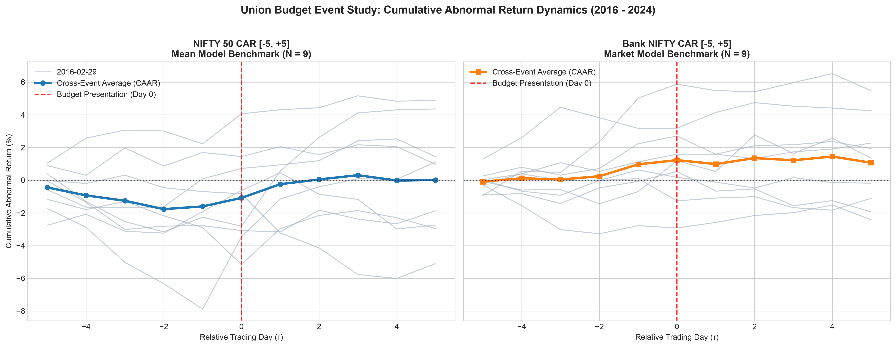

# Union Budget Event Study: Findings & Empirical Analysis (2016–2024)

This report details the empirical findings from an event study evaluating the market impact of **9 Government of India Union Budget presentations** (2016 to 2024) on the **NIFTY 50**, **Bank NIFTY**, **India VIX**, and **USD/INR**.

---

## 1. Executive Summary

| Metric | Sample Mean | Standard Error ($SE$) | $t$-statistic | $p$-value ($t$-test) | Statistically Significant at 5%? |
| :--- | :---: | :---: | :---: | :---: | :---: |
| **NIFTY 50 Day-0 Abnormal Return** | $+0.520\%$ | $0.624\%$ | $+0.833$ | $0.4289$ | **No** (Fail to reject $H_0$) |
| **NIFTY 50 $CAR[-1, +1]$** | $+1.526\%$ | $0.844\%$ | $+1.807$ | $0.1083$ | **No** (Fail to reject $H_0$) |
| **NIFTY 50 $CAR[0, +5]$** | $+1.613\%$ | $1.351\%$ | $+1.194$ | $0.2666$ | **No** (Fail to reject $H_0$) |
| **Bank NIFTY Day-0 Abnormal Return** | $+0.259\%$ | $0.301\%$ | $+0.858$ | $0.4157$ | **No** (Fail to reject $H_0$) |
| **Bank NIFTY $CAR[-1, +1]$** | $+0.744\%$ | $0.417\%$ | $+1.786$ | $0.1119$ | **No** (Fail to reject $H_0$) |
| **Bank NIFTY $CAR[0, +5]$** | $+0.100\%$ | $0.405\%$ | $+0.247$ | $0.8108$ | **No** (Fail to reject $H_0$) |
| **India VIX Day-0 Level Change** | **$-1.673$ pts** | **$0.242$ pts** | **$-6.926$** | **$0.0001$** | **Yes** ($p < 0.001$, Reject $H_0$) |
| **USD/INR Day-0 Level Change** | $-0.104$ INR | $0.067$ INR | $-1.563$ | $0.1567$ | **No** (Fail to reject $H_0$) |

### Key Conclusions:
1. **No Statistically Significant Abnormal Equity Return**: Across the 9 budget presentations, neither NIFTY 50 nor Bank NIFTY exhibited statistically significant abnormal returns on Day 0 or over the multi-day announcement windows ($CAR[-1, +1]$ and $CAR[0, +5]$). While the sample mean CAR is positive (+1.53% for NIFTY 50), cross-event variance is wide (ranging from $-2.76\%$ to $+5.17\%$), yielding a $p$-value of $0.1083$.
2. **Universal Implied Volatility Crush**: The single statistically robust phenomenon is the **collapse in India VIX on Day 0** ($\text{mean} = -1.67\text{ points}, p = 0.0001$). VIX declined on **all 9 events without exception**. The market consistently bids up implied volatility prior to the Budget to insure against unexpected policy shifts, and rapidly deflates this uncertainty premium once announcements are public.
3. **Muted Currency Response**: USD/INR moved by an average of $-0.10$ INR per USD (slight rupee appreciation), but this move is statistically indistinguishable from zero ($p = 0.1567$).

---

## 2. Event-by-Event Results Table

*Source: `data/clean/budget_event_study.parquet` & `market_daily.parquet`*

| Event Date | Effective Trading Day 0 | Presentation Day Market Open? | Budget Type | NIFTY Day 0 AR (%) | NIFTY $CAR[-1,+1]$ (%) | NIFTY $CAR[0,+5]$ (%) | Bank NIFTY Day 0 AR (%) | Bank NIFTY $CAR[-1,+1]$ (%) | Bank NIFTY $CAR[0,+5]$ (%) | India VIX Day 0 $\Delta$ (pts) | USD/INR Day 0 $\Delta$ (₹) | Key Policy / Macro Context |
| :---: | :---: | :---: | :---: | :---: | :---: | :---: | :---: | :---: | :---: | :---: | :---: | :--- |
| **2016-02-29** | 2016-02-29 | Yes | Regular | $-0.55\%$ | $+3.72\%$ | $+6.62\%$ | $+1.88\%$ | $+1.98\%$ | $+2.05\%$ | $-1.71$ | $-0.07$ | Fiscal prudence reaffirmed; strong post-budget relief rally. |
| **2017-02-01** | 2017-02-01 | Yes | Regular | $+1.84\%$ | $+1.30\%$ | $+2.66\%$ | $+0.47\%$ | $+1.05\%$ | $+0.82\%$ | $-2.86$ | $-0.32$ | Presentation date shifted to Feb 1; fiscal deficit target 3.2%. |
| **2018-02-01** | 2018-02-01 | Yes | Regular | $-0.14\%$ | $-2.76\%$ | $-4.40\%$ | $-0.45\%$ | $-0.10\%$ | $-0.81\%$ | $-1.82$ | $-0.10$ | 10% Long-Term Capital Gains (LTCG) tax reintroduced; market selloff. |
| **2019-02-01** | 2019-02-01 | Yes | Interim | $+0.63\%$ | $+2.57\%$ | $+1.35\%$ | $-1.36\%$ | $-1.08\%$ | $-1.21\%$ | $-1.40$ | $+0.08$ | Pre-election PM-KISAN cash transfer; consumption stimulus. |
| **2020-02-01** | 2020-02-03 | **No** (Sat $\to$ Mon) | Regular | $-2.25\%$ | $-0.79\%$ | $-0.06\%$ | $+0.47\%$ | $+0.88\%$ | $+0.04$ | $-1.59$ | $-0.14$ | New optional tax regime; DDT abolished; emergence of early COVID news. |
| **2021-02-01** | 2021-02-01 | Yes | Regular | $+4.41\%$ | $+5.17\%$ | $+8.99\%$ | $+0.85\%$ | $+3.14\%$ | $+0.44\%$ | $-2.02$ | $-0.03$ | Massive post-COVID capex boost; no new COVID taxes levied. |
| **2022-02-01** | 2022-02-01 | Yes | Regular | $+1.29\%$ | $+3.69\%$ | $-0.82\%$ | $+0.01\%$ | $+0.32\%$ | $+1.08\%$ | $-1.97$ | $-0.48$ | Gati Shakti infrastructure focus; 30% crypto tax introduced. |
| **2023-02-01** | 2023-02-01 | Yes | Regular | $-0.30\%$ | $-0.35\%$ | $+0.91\%$ | $-0.14\%$ | $+0.69\%$ | $+0.36\%$ | $-0.10$ | $+0.19$ | Capex hiked to ₹10 lakh cr; revised new tax regime slabs. |
| **2024-02-01** | 2024-02-01 | Yes | Interim | $-0.25\%$ | $+1.18\%$ | $-0.73\%$ | $+0.60\%$ | $-0.20\%$ | $-1.87\%$ | $-1.59$ | $-0.06$ | Fiscal consolidation (5.1% target); minimal tax revisions. |
| **Average** | — | — | — | **$+0.52\%$** | **$+1.53\%$** | **$+1.61\%$** | **$+0.26\%$** | **$+0.74\%$** | **$+0.10\%$** | **$-1.67$** | **$-0.10$** | **Cross-Event Mean** |
| **Std Error** | — | — | — | **$0.62\%$** | **$0.84\%$** | **$1.35\%$** | **$0.30\%$** | **$0.42\%$** | **$0.41\%$** | **$0.24$** | **$0.07$** | **Standard Error ($s / \sqrt{N}$)** |

---

## 3. Visual Trajectory Analysis

The chart above displays the cumulative abnormal return trajectories across the $[-5, +5]$ event window:
- **Individual event paths** (light gray lines) illustrate large dispersion across different budget years. In 2021 (post-COVID capex budget), NIFTY 50 experienced a dramatic $+8.99\%$ CAR drift over $[0, +5]$, whereas in 2018 (reintroduction of LTCG tax), NIFTY suffered a $-4.40\%$ downward drift.
- **Cross-event average CAAR** (bold blue line for NIFTY 50, bold orange line for Bank NIFTY) remains largely flat prior to Day 0, rises slightly between Day 0 and Day +2, and levels off without demonstrating strong directional persistence.

---

## 4. Methodological Limitations

When interpreting these results, several critical limitations must be explicitly considered:

### 1. Small Sample Size ($N = 9$)
With only 9 budget events between 2016 and 2024, the cross-sectional statistical power of Student's $t$-tests is inherently constrained. A sample of 9 observations requires a $t$-statistic of $|t| \ge 2.306$ to reach the conventional $5\%$ significance threshold ($df = 8$). While the observed mean NIFTY $CAR[-1, +1]$ of $+1.53\%$ is economically meaningful, the standard error of $0.84\%$ ($t = 1.807, p = 0.108$) means that sampling error cannot be ruled out. The findings should be treated as **indicative historical observations, not definitive statistical laws**.

### 2. Overlapping Macro Confounders
No national budget takes place in a vacuum:
- **2020 Budget**: Presented just as initial reports of the COVID-19 outbreak in Wuhan emerged globally, culminating in the March 2020 global liquidity shock.
- **Global Interest Rate Cycles**: The 2018 and 2022–2023 budgets coincided with US Federal Reserve monetary tightening cycles and foreign institutional investor (FII) capital reallocation.
- **Geopolitical Shocks**: Pre-budget and post-budget windows frequently coincide with global crude oil price swings and geopolitical tension.

### 3. Structural Heterogeneity: Interim vs. Full Budgets
The sample pools **7 Full Budgets** and **2 Interim Budgets** (February 2019 and February 2024):
- Interim budgets are constitutional "votes on account" intended to fund government operations until elections conclude; by convention, major structural taxation overhauls are avoided.
- Full budgets carry far higher policy scope. Treating interim and regular budgets identically introduces structural heterogeneity into the cross-sectional mean.

### 4. Presentation During Active Market Hours
Unlike US corporate earnings releases (which occur pre-market or after-hours), the Union Budget speech begins at **11:00 AM IST on the presentation day**:
- The announcement unfolds sequentially over 90 to 120 minutes during live exchange trading.
- Markets frequently experience severe intraday swings (spiking on corporate tax cuts, crashing on capital gains tax increases, whipsawing on sector capex allocations) before settling by 3:30 PM IST.
- Daily close-to-close returns compress these large intraday volatility spikes into a single net move, understating the actual execution risk faced by intraday market participants.

### 5. Association vs. Causation
An event study measures **empirical co-movement** within relative trading windows around a known announcement date. A positive cumulative abnormal return indicates that equity prices outperformed their historical mean during the window, but does **not prove that the budget provisions caused the rally**. Other concurrent macro developments, international market co-movements, and corporate earnings releases occurring in the same trading days contribute to observed returns.
